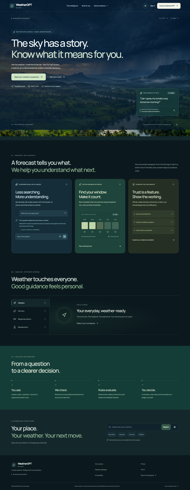
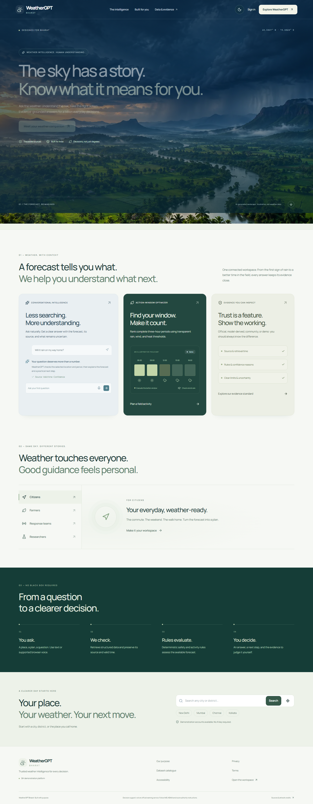
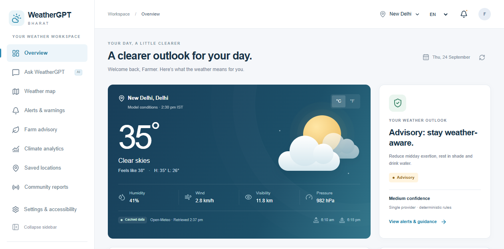
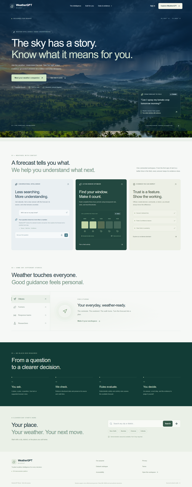
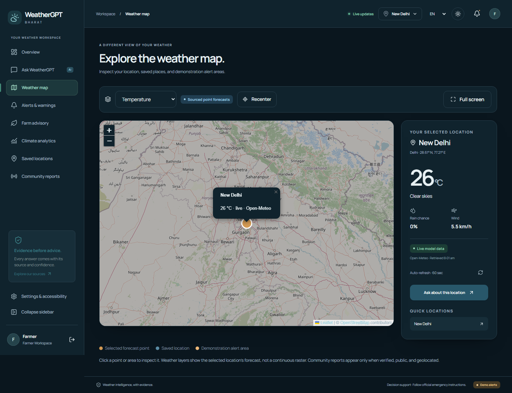
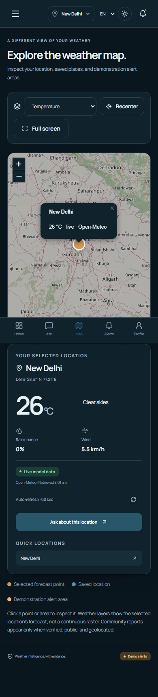
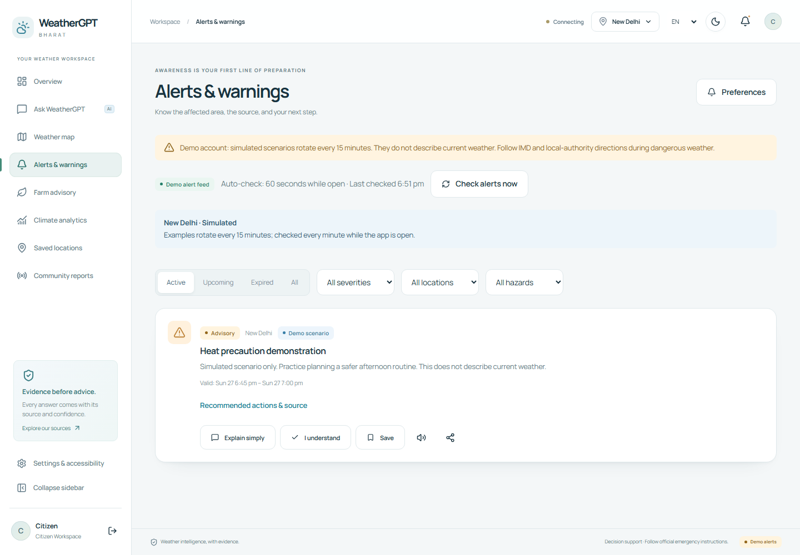
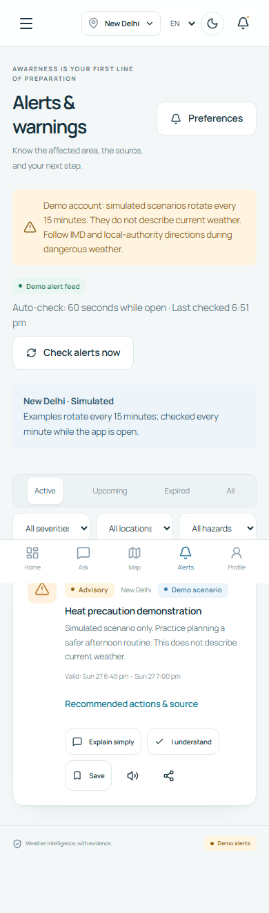

# WeatherGPT Bharat

[](https://weathergpt-bharat-theta.vercel.app)


**Live application:** [weathergpt-bharat-theta.vercel.app](https://weathergpt-bharat-theta.vercel.app)

WeatherGPT Bharat is a responsive weather decision-support platform. It combines a cinematic GSAP and Framer Motion experience with sourced forecasts, agriculture action windows, account-specific alerts, historical climate analysis, community observations and an administrator workspace.



Latest release and verification: [deployment notes](docs/DEPLOYMENT.md). Live-update behavior: [update guide](docs/LIVE-UPDATES.md).

Account flows and the remaining email-service setup: [authentication guide](docs/AUTHENTICATION.md). Public email signup and recovery stay unavailable until a verified service is configured and `AUTH_EMAIL_ENABLED=true` is deployed.

Demo accounts receive clearly labelled simulated scenarios. Personal accounts receive fresh forecast-based advisories with no demo fallback. [Alert behavior and limits](docs/ALERTS.md).

## Product preview

| Light landing experience | Dark landing experience |
|---|---|
|  |  |

| Live dashboard | Hosted landing page |
|---|---|
|  |  |

| Interactive map | Responsive mobile map |
|---|---|
|  |  |

| Account-specific alert feed | Mobile alert feed |
|---|---|
|  |  |

## Technology

- Next.js 16 App Router, React 19, TypeScript 6 and Tailwind CSS 4.
- Supabase authentication, Postgres row-level security, private Storage and realtime events.
- GSAP and Framer Motion for motion, Leaflet and OpenStreetMap for maps, Recharts for analysis.
- Open-Meteo forecast, ERA5, CAMS, marine, NOAA GFS and NASA POWER adapters with source timestamps.
- Vitest, Testing Library, PGlite and Playwright coverage, plus Vercel deployment from Mumbai.

The main data flow is `location → validated provider response → versioned risk rules → sourced decision guidance`. Read the [architecture notes](docs/ARCHITECTURE.md) for authorization and data-flow details.

## Run locally

Requires Node.js 24 and npm. From this directory:

```sh
npm ci
cp .env.example .env.local
npm run dev
```

Open http://localhost:3000. Set `NEXT_PUBLIC_DEMO_MODE=true` for the local SQLite demonstration. Leave Supabase values empty for local mode. SQLite data is stored in `.data/demo.sqlite`; never deploy this persistence mode to a serverless host. A production local-mode server also requires a strong `DEMO_SESSION_SECRET`.

For the hosted database, set `NEXT_PUBLIC_SUPABASE_URL` and `NEXT_PUBLIC_SUPABASE_PUBLISHABLE_KEY`. Authentication, application records, report images and realtime events then use Supabase. The deployed demonstration already has its migration and sample accounts installed.

## Demonstration accounts

These accounts share demonstration data with other visitors. Do not enter personal information or genuine incident reports into them.

| Persona | Email | Password |
|---|---|---|
| Citizen | citizen@weathergpt.demo | Citizen@12345 |
| Farmer | farmer@weathergpt.demo | Farmer@12345 |
| Administrator | admin@weathergpt.demo | Admin@12345 |

Select a demo button on the login page, then **Sign in**. Demo roles are database-assigned; selecting a persona does not grant administration access.

## What works

- Responsive landing page, GSAP scroll sequences, Framer Motion interactions, generated landscape artwork, mobile navigation, reduced-motion support, light/dark themes.
- Seven-day forecast, hourly charts, city search, coordinate selection, saved places and Leaflet/OpenStreetMap map.
- Weather chat with location/time interpretation, deterministic evidence-grounded answers, source timestamps, confidence reasons, evidence hashes and persisted conversation history.
- Agriculture action windows, farm profiles and saved advisories. Thresholds are labelled as demonstration rules pending expert validation.
- Real ERA5 historical reanalysis with monthly summaries, comparison to 2020, heat-day counts, chart/table views and CSV export. A separate synthetic option is explicitly labelled.
- Community reporting with consent, private validated image uploads, administrator verification and an append-only audit trail.
- Alert drafts, publication, expiry, severity filters, saved alert interests, in-app notifications and Supabase realtime updates, transactional review notifications and matching published-alert delivery.
- Profile preferences, Hindi navigation/browser voice input, offline fallback showing the last saved forecast, dataset catalogue and public source references.

## Data sources

The catalogue describes 15 sources. Six public adapters make real requests: Open-Meteo forecast, NOAA GFS through Open-Meteo, ERA5 through Open-Meteo, CAMS air quality through Open-Meteo, Open-Meteo marine and NASA POWER. This does **not** mean every dataset has been downloaded or integrated. IMD, MOSDAC, Bhuvan and other restricted sources are clearly marked as reference or approval-required.

API samples and status evidence are in `docs/source-verification.json`. `scripts/check-public-sources.mjs` repeats those checks. Sources, attribution and access limits are visible at `/datasets` and `/data-sources`.

